  

## Sobre mim

Sou o **Hugo**, de Campina Grande (PB). Estou finalizando Sistemas de Informação na UniFacisa e gosto de transformar ideias em software.

<!-- EDITE as linhas abaixo ou apague as que não quiser -->
- Estudando e construindo agora: **[o que você está aprendendo ou criando]**
- Procurando: **[estágio, vaga, freelas ou networking]**
- Pode falar comigo sobre: **[assuntos em que você pode ajudar]**

## Linguagens e atividade

<!-- Troque as duas ocorrências de SEU-USUARIO pelo seu nome de usuário do GitHub.
     O link abre o SVG puro, onde o efeito do mouse funciona. Se não abrir bem, apague só a tag <a>. -->

  

## Contato

| Canal | Link |
|:--|:--|
| LinkedIn | [linkedin.com/in/SEU-USUARIO](https://linkedin.com/in/SEU-USUARIO) |
| E-mail | [seu@email.com](mailto:seu@email.com) |
| Instagram | [@SEU-USUARIO](https://instagram.com/SEU-USUARIO) |
| Portfólio | [seu-site.com](https://seu-site.com) |
<!-- apague as linhas que não usar ou copie uma linha para adicionar outra rede -->
