  

## Sobre mim

Sou o **Hugo**, de Campina Grande (PB). Estou finalizando Sistemas de Informação na UniFacisa e gosto de transformar ideias em software.

<!-- EDITE as linhas abaixo ou apague as que não quiser -->
- Estudando e construindo agora: **[o que você está aprendendo ou criando]**
- Procurando: **[estágio, vaga, freelas ou networking]**
- Pode falar comigo sobre: **[assuntos em que você pode ajudar]**

## Linguagens e atividade

<!-- Troque as duas ocorrências de SEU-USUARIO pelo seu nome de usuário do GitHub.
     O link abre o SVG puro, onde o efeito do mouse funciona. Se não abrir bem, apague só a tag <a>. -->

  

## Contato

  
  
  
  
  
  

<!-- apague as linhas que não usar ou copie uma linha para adicionar outra rede -->
